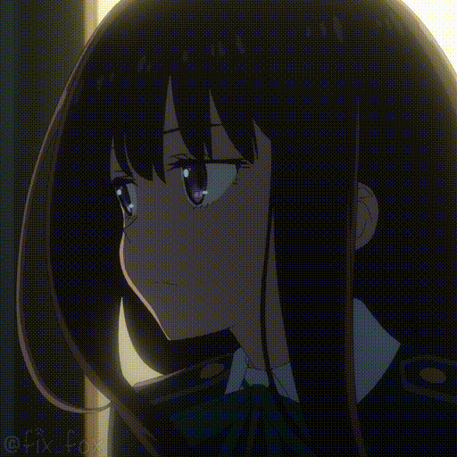

# 「 kuroyam1 」

<i>kernel gremlin · AOSP tree hoarder · 3AM debugger</i>

 

 

---

<table align="center">
<tr>
<td valign="middle"></td>
<td valign="middle" align="center">

 

</td>
</tr>
</table>

---

> *"If it boots, it's not finished — it's just not broken yet."*

🌸 GIF assets belong to their respective studios · fan edits

